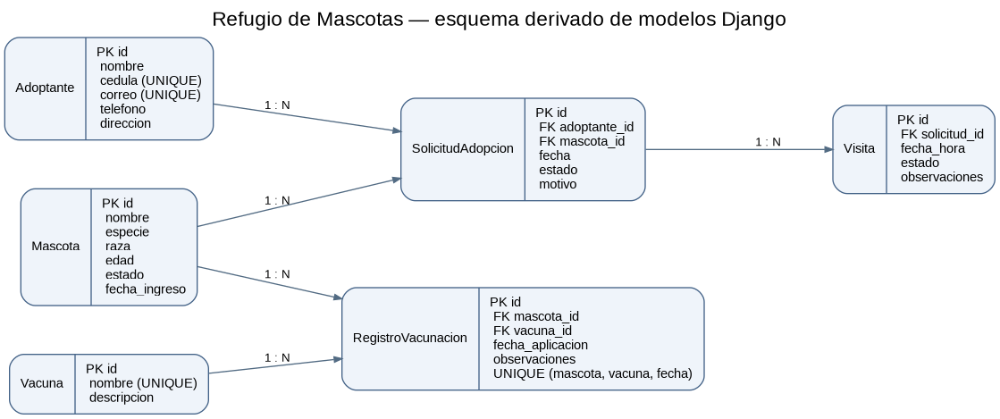

DOCUMENTACIÓN TÉCNICA
Sistema de Gestión del Refugio de Mascotas
Tecnología: Django REST Framework y MySQL
Objetivo: Describir el modelo de datos, la seguridad, las reglas de negocio y los servicios de la API.
1. DIAGRAMA ENTIDAD–RELACIÓN

El sistema administra seis entidades principales:
- Mascota: información de los animales del refugio.
- Adoptante: datos de las personas interesadas en adoptar.
- SolicitudAdopcion: relaciona una mascota con un adoptante.
- Visita: evaluación o seguimiento vinculado a una solicitud.
- Vacuna: catálogo de vacunas.
- RegistroVacunacion: relaciona una mascota, una vacuna y su fecha de aplicación.
Las relaciones entre estas entidades utilizan claves foráneas con protección ante eliminaciones que dejarían registros relacionados sin su entidad principal (on_delete=PROTECT). Existen restricciones de unicidad para la cédula y el correo de los adoptantes, el nombre de las vacunas y la combinación de mascota, vacuna y fecha de vacunación.
Imagen del modelo de datos


El diagrama se generó en MySQL Workbench con Database → Reverse Engineer sobre refugio_db; el modelo editable está en docs/diagrama.mwb.
2. MATRIZ DE PERMISOS
La API controla las operaciones según el tipo de usuario.
Administrador
- GET: permitido.
- POST: permitido.
- PUT: permitido.
- PATCH: permitido.
- DELETE: permitido.
- Estadísticas: permitidas.
- Identificación: usuario con is_staff=True.
Operador
- GET: permitido.
- POST: permitido.
- PUT: permitido.
- PATCH: permitido.
- DELETE: denegado; responde 403 Forbidden.
- Estadísticas: permitidas.
- Identificación: usuario perteneciente al grupo Operador.
Usuario de consulta
- GET: permitido.
- POST, PUT, PATCH y DELETE: denegados; responden 403 Forbidden.
- Estadísticas: permitidas si está autenticado.
- Identificación: usuario autenticado sin privilegios de administrador ni del grupo Operador.
Usuario sin autenticación
- GET de recursos públicos: permitido.
- POST, PUT, PATCH y DELETE: denegados; responden 401 Unauthorized.
- Estadísticas: denegadas; responden 401 Unauthorized.
Implementación: config/permisos.py y config/views.py. Los permisos se aplican a las operaciones, además de las validaciones realizadas en los serializers.
3. REGLAS DE NEGOCIO (R1–R10)
Las reglas están implementadas en los serializers de las distintas aplicaciones.
R1. No solicitar una mascota adoptada
No se permite crear o modificar una solicitud para una mascota cuyo estado ya es adoptada.

Ubicación: solicitudes/serializers.py.
R2. Visita obligatoria antes de aprobar
Para aprobar una solicitud debe existir al menos una visita relacionada cuyo estado sea realizada.

Ubicación: solicitudes/serializers.py.
R3. Una sola aprobación por mascota
Una mascota no puede tener simultáneamente dos solicitudes de adopción aprobadas.

Ubicación: solicitudes/serializers.py.
R4. Evitar solicitudes pendientes repetidas
Un adoptante no puede registrar dos solicitudes en estado pendiente para la misma mascota.

Ubicación: solicitudes/serializers.py.
R5. No programar visitas en el pasado
La fecha y hora de una visita programada deben ser posteriores al momento actual.

Ubicación: visitas/serializers.py.
R6. Evitar choques de horario
No pueden existir dos visitas en estado programada para la misma fecha y hora.

Ubicación: visitas/serializers.py.
R7. No visitar solicitudes rechazadas
No se permite crear una visita para una solicitud rechazada ni reasignar una visita a una solicitud rechazada.

Ubicación: visitas/serializers.py.
R8. Fecha de vacunación válida
La fecha de aplicación de una vacuna no puede ser posterior a la fecha actual.

Ubicación: salud/serializers.py.
R9. Edad válida de la mascota
La edad de una mascota se expresa en meses y debe estar entre 1 y 360, inclusive.

Ubicación: mascotas/serializers.py.
R10. Cambio automático de estado al aprobar
Al actualizar una solicitud al estado aprobada, la mascota asociada cambia automáticamente a adoptada.

Ubicación: solicitudes/serializers.py.

Comportamiento: las reglas R1 a R9 pueden producir 400 Bad Request por validación. R10 produce una actualización del estado y no representa por sí misma un error de validación.
4. CATÁLOGO DE ENDPOINTS
URL local de ejemplo: http://127.0.0.1:8000
4.1 Autenticación
POST /api/token/
Obtiene el token utilizando las credenciales del usuario.
4.2 Mascotas
GET /api/mascotas/ — lista paginada de mascotas.
POST /api/mascotas/ — registra una mascota.
GET /api/mascotas/{id}/ — consulta una mascota.
PUT/PATCH /api/mascotas/{id}/ — actualiza una mascota.
DELETE /api/mascotas/{id}/ — elimina una mascota, según permisos y restricciones.

Parámetros de GET /api/mascotas/:
- pagina: número de página, con 5 resultados por página.
- especie: filtro por especie exacta, por ejemplo perro o gato.
- estado: filtro por disponible, en_proceso o adoptada.
- buscar: busca contenido en el nombre o la raza, sin distinguir mayúsculas.
- orden: nombre, edad o fecha_ingreso; añadir - al inicio para orden descendente. Un valor inválido produce 400.
4.3 Adoptantes
GET /api/adoptantes/ — lista adoptantes.
POST /api/adoptantes/ — registra un adoptante.
GET /api/adoptantes/{id}/ — consulta un adoptante.
PUT/PATCH /api/adoptantes/{id}/ — modifica un adoptante.
DELETE /api/adoptantes/{id}/ — elimina un adoptante si las relaciones lo permiten.
4.4 Solicitudes de adopción
GET /api/solicitudes/ — lista paginada de solicitudes.
POST /api/solicitudes/ — registra una solicitud.
GET /api/solicitudes/{id}/ — consulta una solicitud.
PUT/PATCH /api/solicitudes/{id}/ — modifica una solicitud.
DELETE /api/solicitudes/{id}/ — elimina una solicitud según permisos.

Parámetros de GET /api/solicitudes/:
- pagina: número de página, con 5 resultados por página.
- estado: filtro por pendiente, aprobada o rechazada.
- adoptante: identificador numérico del adoptante; valor no numérico produce 400.
- mascota: identificador numérico de la mascota; valor no numérico produce 400.
4.5 Visitas
GET /api/visitas/ — lista las visitas.
POST /api/visitas/ — registra una visita.
GET /api/visitas/{id}/ — consulta una visita.
PUT/PATCH /api/visitas/{id}/ — modifica una visita.
DELETE /api/visitas/{id}/ — elimina una visita según permisos.
4.6 Vacunas
GET /api/salud/vacunas/ — lista las vacunas.
POST /api/salud/vacunas/ — registra una vacuna.
GET /api/salud/vacunas/{id}/ — consulta una vacuna.
PUT/PATCH /api/salud/vacunas/{id}/ — modifica una vacuna.
DELETE /api/salud/vacunas/{id}/ — elimina una vacuna según permisos.
4.7 Registros de vacunación
GET /api/salud/registros/ — lista registros de vacunación.
POST /api/salud/registros/ — registra una vacunación.
GET /api/salud/registros/{id}/ — consulta un registro.
PUT/PATCH /api/salud/registros/{id}/ — modifica un registro.
DELETE /api/salud/registros/{id}/ — elimina un registro según permisos.
4.8 Estadísticas
GET /api/estadisticas/ — presenta estadísticas agregadas del refugio, como mascotas disponibles por especie, solicitudes, aplicaciones de vacunas y próximas visitas. Requiere autenticación.
GET /api/perfil/ — devuelve username, rol (administrador, operador o consulta) y las banderas puede_crear, puede_editar y puede_borrar del usuario autenticado. Requiere token; sin token responde 401.
4.9 Ejemplos de consultas
Mascotas disponibles de especie gato:

GET /api/mascotas/?especie=gato&estado=disponible

Buscar Luna, ordenar por edad descendente y consultar página 1:

GET /api/mascotas/?buscar=luna&orden=-edad&pagina=1

Solicitudes pendientes filtradas por adoptante y mascota:

GET /api/solicitudes/?adoptante=1&mascota=2&estado=pendiente

Estadísticas con token:

GET /api/estadisticas/
Authorization: Token TU_TOKEN

Las respuestas paginadas incluyen pagina_actual, total_paginas, total_registros y resultados (config/paginacion.py). Las consultas estadísticas están implementadas en config/views.py.


5. INVENTARIO DE ENDPOINTS PARA EL FRONTEND

Este inventario reúne, para cada endpoint que usa la interfaz React, la autenticación, los permisos, los parámetros, la estructura JSON y los códigos de respuesta. La relación de cada pantalla con su endpoint está en docs/matriz_pantallas_endpoints.md.

5.1 Convenciones comunes

- Autenticación: cabecera `Authorization: Token <token>`, obtenido con `POST /api/token/`.
- Permisos (config/permisos.py): GET es público; POST, PUT y PATCH requieren administrador u operador; DELETE requiere administrador.
- Sin token en una escritura: `401 {"detail": "Debe autenticarse para realizar esta accion."}`.
- Con token pero sin permiso: `403 {"detail": "No tiene permisos para realizar esta accion."}`.
- Registro inexistente: `404 {"error": "<Recurso> no encontrado(a)."}`.
- Error de validación o regla de negocio: `400` con un objeto por campo, por ejemplo `{"edad": ["La edad debe ser mayor que 0 meses"]}`, o `{"non_field_errors": ["..."]}` cuando la regla involucra varios campos.
- Eliminación bloqueada por datos relacionados: `409 {"error": "No se puede eliminar: ..."}`.
- Eliminación correcta: `204` sin cuerpo.
- Respuesta paginada (mascotas y solicitudes, 5 por página):

```json
{
  "pagina_actual": 1,
  "total_paginas": 2,
  "total_registros": 7,
  "resultados": [ { "...": "..." } ]
}
```

5.2 Tabla de endpoints

| Endpoint | Método | Token | Perfiles | Parámetros | Códigos |
|---|---|---|---|---|---|
| /api/token/ | POST | No | Cualquiera | Cuerpo: username, password | 200, 400 |
| /api/perfil/ | GET | Sí | Autenticados | — | 200, 401 |
| /api/estadisticas/ | GET | Sí | Autenticados | — | 200, 401 |
| /api/mascotas/ | GET | No | Todos | pagina, especie, estado, buscar, orden, todos=1 | 200, 400 (orden inválido) |
| /api/mascotas/ | POST | Sí | Admin, Operador | Cuerpo de Mascota | 201, 400, 401, 403 |
| /api/mascotas/{id}/ | GET | No | Todos | — | 200, 404 |
| /api/mascotas/{id}/ | PUT / PATCH | Sí | Admin, Operador | Cuerpo de Mascota | 200, 400, 401, 403, 404 |
| /api/mascotas/{id}/ | DELETE | Sí | Admin | — | 204, 401, 403, 404, 409 |
| /api/adoptantes/ | GET | No | Todos | — | 200 |
| /api/adoptantes/ | POST | Sí | Admin, Operador | Cuerpo de Adoptante | 201, 400, 401, 403 |
| /api/adoptantes/{id}/ | GET | No | Todos | — | 200, 404 |
| /api/adoptantes/{id}/ | PUT / PATCH | Sí | Admin, Operador | Cuerpo de Adoptante | 200, 400, 401, 403, 404 |
| /api/adoptantes/{id}/ | DELETE | Sí | Admin | — | 204, 401, 403, 404, 409 |
| /api/solicitudes/ | GET | No | Todos | pagina, estado, adoptante, mascota, todos=1 | 200, 400 (id no numérico) |
| /api/solicitudes/ | POST | Sí | Admin, Operador | Cuerpo de Solicitud | 201, 400 (R1, R4), 401, 403 |
| /api/solicitudes/{id}/ | GET | No | Todos | — | 200, 404 |
| /api/solicitudes/{id}/ | PUT / PATCH | Sí | Admin, Operador | Cuerpo parcial, p. ej. {"estado": "aprobada"} | 200, 400 (R2, R3), 401, 403, 404 |
| /api/solicitudes/{id}/ | DELETE | Sí | Admin | — | 204, 401, 403, 404, 409 |
| /api/visitas/ | GET | No | Todos | solicitud | 200, 400 (id no numérico) |
| /api/visitas/ | POST | Sí | Admin, Operador | Cuerpo de Visita | 201, 400 (R5, R6, R7), 401, 403 |
| /api/visitas/{id}/ | GET | No | Todos | — | 200, 404 |
| /api/visitas/{id}/ | PUT / PATCH | Sí | Admin, Operador | Cuerpo de Visita | 200, 400, 401, 403, 404 |
| /api/visitas/{id}/ | DELETE | Sí | Admin | — | 204, 401, 403, 404 |
| /api/salud/vacunas/ | GET | No | Todos | — | 200 |
| /api/salud/vacunas/ | POST | Sí | Admin, Operador | Cuerpo de Vacuna | 201, 400 (nombre repetido), 401, 403 |
| /api/salud/vacunas/{id}/ | GET | No | Todos | — | 200, 404 |
| /api/salud/vacunas/{id}/ | PUT / PATCH | Sí | Admin, Operador | Cuerpo de Vacuna | 200, 400, 401, 403, 404 |
| /api/salud/vacunas/{id}/ | DELETE | Sí | Admin | — | 204, 401, 403, 404, 409 |
| /api/salud/registros/ | GET | No | Todos | — | 200 |
| /api/salud/registros/ | POST | Sí | Admin, Operador | Cuerpo de Registro | 201, 400 (R8, duplicado), 401, 403 |
| /api/salud/registros/{id}/ | GET | No | Todos | — | 200, 404 |
| /api/salud/registros/{id}/ | PUT / PATCH | Sí | Admin, Operador | Cuerpo de Registro | 200, 400, 401, 403, 404 |
| /api/salud/registros/{id}/ | DELETE | Sí | Admin | — | 204, 401, 403, 404 |

5.3 Estructura JSON de cada recurso

Los campos `id` y los marcados como "solo lectura" los genera el servidor; no se envían al crear. Las relaciones se envían y se reciben como el id numérico de la entidad relacionada.

Autenticación

```json
// POST /api/token/  (envío)
{ "username": "consulta1", "password": "galagarza" }
// 200 (respuesta)
{ "token": "9944b09199c62bcf9418ad846dd0e4bbdfc6ee4b" }
// 400 con credenciales incorrectas
{ "non_field_errors": ["No puede iniciar sesión con las credenciales proporcionadas."] }
```

Perfil

```json
// GET /api/perfil/  200
{ "username": "operador", "rol": "operador", "puede_crear": true, "puede_editar": true, "puede_borrar": false }
```

Estadísticas

```json
// GET /api/estadisticas/  200
{
  "mascotas_disponibles_por_especie": [{ "especie": "perro", "total": 3 }],
  "mascota_con_mas_solicitudes": { "id": 3, "nombre": "Mishi", "total_solicitudes": 2 },
  "adoptantes_con_solicitudes_aprobadas": [{ "id": 1, "nombre": "Maria Fernanda", "solicitudes_aprobadas": 1 }],
  "vacunas_mas_aplicadas": [{ "id": 1, "nombre": "Rabia", "total_aplicaciones": 2 }],
  "proximas_visitas": [{ "id": 4, "fecha_hora": "2026-12-01T15:00:00Z", "adoptante": "Carlos", "mascota": "Toby" }],
  "mascotas_con_sus_vacunas": [{ "mascota": "Mishi", "vacunas": ["Rabia", "Triple felina"] }]
}
```

Mascota

```json
{
  "id": 1,
  "nombre": "Toby",
  "especie": "perro",            // perro | gato
  "raza": "Dachshund",           // opcional
  "edad": 25,                    // meses, entre 1 y 360 (R9)
  "descripcion": "Perrito cariñoso y juguetón.",  // opcional
  "estado": "disponible",        // disponible | en_proceso | adoptada
  "fecha_ingreso": "2026-11-21"  // solo lectura
}
```

Adoptante

```json
{
  "id": 1,
  "nombre": "Maria Fernanda",
  "cedula": "1-1234-0567",       // única
  "correo": "maria.rojas@example.com",  // único
  "telefono": "8888-1111",       // opcional
  "direccion": "Orotina, Centro" // opcional
}
```

Solicitud de adopción

```json
{
  "id": 1,
  "adoptante": 1,                // id del adoptante
  "mascota": 3,                  // id de la mascota
  "fecha": "2026-11-21",         // solo lectura
  "estado": "pendiente",         // pendiente | aprobada | rechazada
  "motivo": "Quiero darle un hogar a una gata tranquila"  // opcional
}
```

Visita

```json
{
  "id": 1,
  "solicitud": 1,                // id de la solicitud
  "fecha_hora": "2026-12-10T10:00:00Z",
  "estado": "programada",        // programada | realizada | cancelada
  "observaciones": "Hogar adecuado"  // opcional
}
```

Vacuna

```json
{ "id": 1, "nombre": "Rabia", "descripcion": "Vacuna antirrábica anual" }
```

Registro de vacunación

```json
{
  "id": 1,
  "mascota": 3,                  // id de la mascota
  "vacuna": 2,                   // id de la vacuna
  "fecha_aplicacion": "2026-03-15",  // no puede ser futura (R8)
  "observaciones": "Sin reacción"    // opcional
}
```

Ejemplos de errores que muestra el frontend

```json
// 400, R1: solicitar una mascota ya adoptada
{ "mascota": ["No se puede solicitar una mascota ya adoptada."] }
// 400, R2: aprobar sin visita realizada
{ "estado": ["No se puede aprobar una solicitud sin al menos una visita realizada."] }
// 409: eliminar una solicitud con visitas
{ "error": "No se puede eliminar: la solicitud tiene visitas registradas." }
```

Nota: la clave exacta de cada error 400 (nombre del campo o non_field_errors) depende de dónde se valida la regla en el serializer; el frontend (frontend/src/utils/errores.js) muestra el mensaje sea cual sea la clave.


6. AMPLIACIONES DEL BACKEND PARA EL FRONTEND (JUSTIFICADAS)

Ninguna ampliación cambia las reglas de negocio ni debilita la seguridad: los nuevos endpoints y parámetros son de solo lectura y conservan los mismos permisos que ya tenía cada recurso.

| Ampliación | Problema que resuelve en la interfaz | Seguridad |
|---|---|---|
| CORS con django-cors-headers (`CORS_ALLOWED_ORIGINS` = localhost:5173 y 127.0.0.1:5173) | Sin CORS, el navegador bloquea las peticiones de la app de Vite (puerto 5173) a la API (puerto 8000). | Solo se permiten los dos orígenes del servidor de desarrollo, no cualquier origen. |
| `GET /api/perfil/` | Después del login, el frontend necesita saber el rol del usuario para mostrar u ocultar los botones de crear, editar y eliminar (usePermisos.js) y para mostrar el usuario en la barra superior. El endpoint de token de DRF solo devuelve el token. | Exige token (401 sin él). Ocultar botones es solo experiencia de usuario: la API sigue respondiendo 403. |
| `GET /api/mascotas/?todos=1` | Los selectores de mascota (nueva solicitud, nuevo registro de vacunación, filtros) necesitan todas las mascotas; con paginación solo llegarían 5. Conserva filtros y orden. | Lectura pública, igual que el listado paginado. |
| `GET /api/solicitudes/?todos=1` | El selector de solicitud al crear una visita y los nombres de la lista de visitas necesitan todas las solicitudes, no solo una página. Conserva filtros. | Lectura pública, igual que el listado paginado. |
| `GET /api/visitas/?solicitud=<id>` | El detalle de una solicitud muestra sus visitas vinculadas sin descargar y filtrar todas las visitas en el navegador. Responde 400 si el id no es numérico. | Lectura pública, igual que el listado de visitas. |

6.1 Limitación del cierre de sesión

DRF con TokenAuthentication no revoca el token al cerrar sesión, y el backend no tiene un endpoint de revocación. El logout del frontend borra el token y el perfil del navegador (localStorage) y redirige a /login, pero el token sigue siendo válido en el servidor hasta que se elimine desde el administrador de Django (Auth Token → Tokens).

6.2 Manejo de 401 en el frontend

Si la API responde 401 en cualquier pantalla (token borrado o inválido), frontend/src/api/cliente.js limpia la sesión local, redirige a /login y la pantalla de login muestra el aviso "Su sesión no es válida o expiró. Inicie sesión de nuevo."