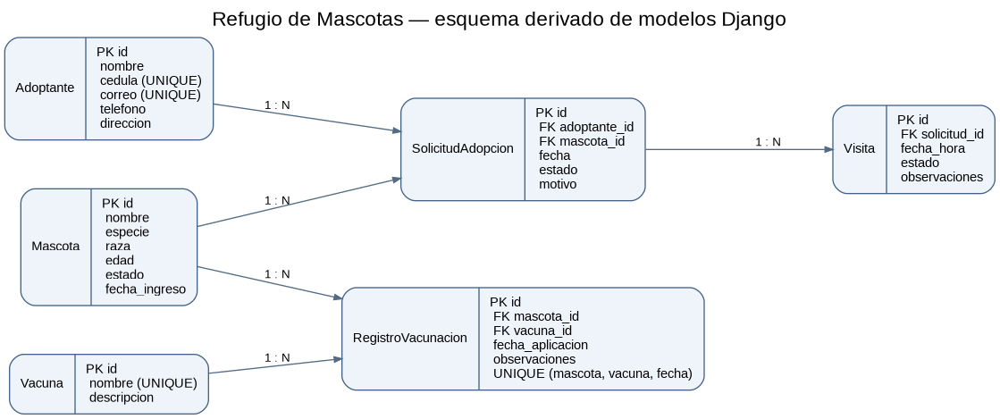

DOCUMENTACIÓN TÉCNICA
Sistema de Gestión del Refugio de Mascotas
Tecnología: Django REST Framework y MySQL
Objetivo: Describir el modelo de datos, la seguridad, las reglas de negocio y los servicios de la API.
1. DIAGRAMA ENTIDAD–RELACIÓN

El sistema administra seis entidades principales:
- Mascota: información de los animales del refugio.
- Adoptante: datos de las personas interesadas en adoptar.
- SolicitudAdopcion: relaciona una mascota con un adoptante.
- Visita: evaluación o seguimiento vinculado a una solicitud.
- Vacuna: catálogo de vacunas.
- RegistroVacunacion: relaciona una mascota, una vacuna y su fecha de aplicación.
Las relaciones entre estas entidades utilizan claves foráneas con protección ante eliminaciones que dejarían registros relacionados sin su entidad principal (on_delete=PROTECT). Existen restricciones de unicidad para la cédula y el correo de los adoptantes, el nombre de las vacunas y la combinación de mascota, vacuna y fecha de vacunación.
Imagen del modelo de datos

Nota de entrega: esta imagen es una representación generada a partir de los modelos Django. Para cumplir el requisito de la tarea, reemplazarla por la imagen exportada desde MySQL Workbench siguiendo Database → Reverse Engineer → refugio_db → Export as PNG y guardándola como docs/diagrama_er.png.
2. MATRIZ DE PERMISOS
La API controla las operaciones según el tipo de usuario.
Administrador
- GET: permitido.
- POST: permitido.
- PUT: permitido.
- PATCH: permitido.
- DELETE: permitido.
- Estadísticas: permitidas.
- Identificación: usuario con is_staff=True.
Operador
- GET: permitido.
- POST: permitido.
- PUT: permitido.
- PATCH: permitido.
- DELETE: denegado; responde 403 Forbidden.
- Estadísticas: permitidas.
- Identificación: usuario perteneciente al grupo Operador.
Usuario de consulta
- GET: permitido.
- POST, PUT, PATCH y DELETE: denegados; responden 403 Forbidden.
- Estadísticas: permitidas si está autenticado.
- Identificación: usuario autenticado sin privilegios de administrador ni del grupo Operador.
Usuario sin autenticación
- GET de recursos públicos: permitido.
- POST, PUT, PATCH y DELETE: denegados; responden 401 Unauthorized.
- Estadísticas: denegadas; responden 401 Unauthorized.
Implementación: config/permisos.py y config/views.py. Los permisos se aplican a las operaciones, además de las validaciones realizadas en los serializers.
3. REGLAS DE NEGOCIO (R1–R10)
Las reglas están implementadas en los serializers de las distintas aplicaciones.
R1. No solicitar una mascota adoptada
No se permite crear o modificar una solicitud para una mascota cuyo estado ya es adoptada.

Ubicación: solicitudes/serializers.py.
R2. Visita obligatoria antes de aprobar
Para aprobar una solicitud debe existir al menos una visita relacionada cuyo estado sea realizada.

Ubicación: solicitudes/serializers.py.
R3. Una sola aprobación por mascota
Una mascota no puede tener simultáneamente dos solicitudes de adopción aprobadas.

Ubicación: solicitudes/serializers.py.
R4. Evitar solicitudes pendientes repetidas
Un adoptante no puede registrar dos solicitudes en estado pendiente para la misma mascota.

Ubicación: solicitudes/serializers.py.
R5. No programar visitas en el pasado
La fecha y hora de una visita programada deben ser posteriores al momento actual.

Ubicación: visitas/serializers.py.
R6. Evitar choques de horario
No pueden existir dos visitas en estado programada para la misma fecha y hora.

Ubicación: visitas/serializers.py.
R7. No visitar solicitudes rechazadas
No se permite crear una visita para una solicitud rechazada ni reasignar una visita a una solicitud rechazada.

Ubicación: visitas/serializers.py.
R8. Fecha de vacunación válida
La fecha de aplicación de una vacuna no puede ser posterior a la fecha actual.

Ubicación: salud/serializers.py.
R9. Edad válida de la mascota
La edad de una mascota se expresa en meses y debe estar entre 1 y 360, inclusive.

Ubicación: mascotas/serializers.py.
R10. Cambio automático de estado al aprobar
Al actualizar una solicitud al estado aprobada, la mascota asociada cambia automáticamente a adoptada.

Ubicación: solicitudes/serializers.py.

Comportamiento: las reglas R1 a R9 pueden producir 400 Bad Request por validación. R10 produce una actualización del estado y no representa por sí misma un error de validación.
4. CATÁLOGO DE ENDPOINTS
URL local de ejemplo: http://127.0.0.1:8000
4.1 Autenticación
POST /api/token/
Obtiene el token utilizando las credenciales del usuario.
4.2 Mascotas
GET /api/mascotas/ — lista paginada de mascotas.
POST /api/mascotas/ — registra una mascota.
GET /api/mascotas/{id}/ — consulta una mascota.
PUT/PATCH /api/mascotas/{id}/ — actualiza una mascota.
DELETE /api/mascotas/{id}/ — elimina una mascota, según permisos y restricciones.

Parámetros de GET /api/mascotas/:
- pagina: número de página, con 5 resultados por página.
- especie: filtro por especie exacta, por ejemplo perro o gato.
- estado: filtro por disponible, en_proceso o adoptada.
- buscar: busca contenido en el nombre o la raza, sin distinguir mayúsculas.
- orden: nombre, edad o fecha_ingreso; añadir - al inicio para orden descendente. Un valor inválido produce 400.
4.3 Adoptantes
GET /api/adoptantes/ — lista adoptantes.
POST /api/adoptantes/ — registra un adoptante.
GET /api/adoptantes/{id}/ — consulta un adoptante.
PUT/PATCH /api/adoptantes/{id}/ — modifica un adoptante.
DELETE /api/adoptantes/{id}/ — elimina un adoptante si las relaciones lo permiten.
4.4 Solicitudes de adopción
GET /api/solicitudes/ — lista paginada de solicitudes.
POST /api/solicitudes/ — registra una solicitud.
GET /api/solicitudes/{id}/ — consulta una solicitud.
PUT/PATCH /api/solicitudes/{id}/ — modifica una solicitud.
DELETE /api/solicitudes/{id}/ — elimina una solicitud según permisos.

Parámetros de GET /api/solicitudes/:
- pagina: número de página, con 5 resultados por página.
- estado: filtro por pendiente, aprobada o rechazada.
- adoptante: identificador numérico del adoptante; valor no numérico produce 400.
- mascota: identificador numérico de la mascota; valor no numérico produce 400.
4.5 Visitas
GET /api/visitas/ — lista las visitas.
POST /api/visitas/ — registra una visita.
GET /api/visitas/{id}/ — consulta una visita.
PUT/PATCH /api/visitas/{id}/ — modifica una visita.
DELETE /api/visitas/{id}/ — elimina una visita según permisos.
4.6 Vacunas
GET /api/salud/vacunas/ — lista las vacunas.
POST /api/salud/vacunas/ — registra una vacuna.
GET /api/salud/vacunas/{id}/ — consulta una vacuna.
PUT/PATCH /api/salud/vacunas/{id}/ — modifica una vacuna.
DELETE /api/salud/vacunas/{id}/ — elimina una vacuna según permisos.
4.7 Registros de vacunación
GET /api/salud/registros/ — lista registros de vacunación.
POST /api/salud/registros/ — registra una vacunación.
GET /api/salud/registros/{id}/ — consulta un registro.
PUT/PATCH /api/salud/registros/{id}/ — modifica un registro.
DELETE /api/salud/registros/{id}/ — elimina un registro según permisos.
4.8 Estadísticas
GET /api/estadisticas/ — presenta estadísticas agregadas del refugio, como mascotas disponibles por especie, solicitudes, aplicaciones de vacunas y próximas visitas. Requiere autenticación.
4.9 Ejemplos de consultas
Mascotas disponibles de especie gato:

GET /api/mascotas/?especie=gato&estado=disponible

Buscar Luna, ordenar por edad descendente y consultar página 1:

GET /api/mascotas/?buscar=luna&orden=-edad&pagina=1

Solicitudes pendientes filtradas por adoptante y mascota:

GET /api/solicitudes/?adoptante=1&mascota=2&estado=pendiente

Estadísticas con token:

GET /api/estadisticas/
Authorization: Token TU_TOKEN

Las respuestas paginadas incluyen pagina_actual, total_paginas, total_registros y resultados (config/paginacion.py). Las consultas estadísticas están implementadas en config/views.py.